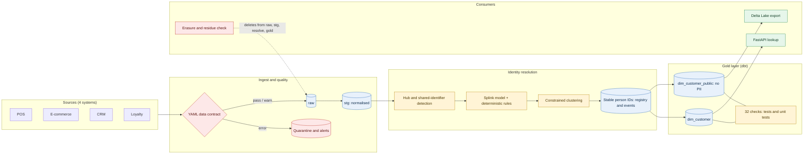

# Customer Identity Platform

[](https://github.com/duan-n2d/customer-identity-platform/actions/workflows/ci.yml)

Identity resolution and a Customer 360 for a retailer whose customers exist in four systems
(POS, e-commerce, CRM, loyalty) with no shared key. The pipeline decides which records are the
same person, keeps that person's ID **stable** from one daily run to the next, builds the golden
record, enforces data contracts, and supports GDPR-style erasure. Everything runs locally on
Python + DuckDB; the gold layer exports to Delta Lake for Databricks.

The data is synthetic (Vietnamese names, phones, addresses) and generated with a hidden ground
truth, so every number below is measured, not claimed.

## Results

<!-- RESULTS:START -->
Synthetic Vietnamese customer data: **400 people**, 1,474 source records across 4 systems, 1 daily increments (seed 7).

| Metric | Result |
|---|---|
| Precision (linked record pairs that are the same person) | **98.02%** |
| Recall on pairs that *can* be linked from the identifiers present | **95.13%** |
| Share of true pairs that share any linking evidence (the data's ceiling) | 37.10% |
| Person-ID stability, record level, day over day | **100.00% to 100.00%** |
| Same, with a naive ID (smallest record key of the cluster) | 99.31% to 99.31% |
| Day-0 load: 1,439 records, train + match + IDs | 3 s |
| Daily run: ~1,474 records, full re-match | 1 s |
<!-- RESULTS:END -->

Full breakdown (per day, error causes, ablation, scale): [docs/evaluation.md](docs/evaluation.md).

## The problem is mostly not the model

Naively linking on phone/email/name merges different people. The data contains traps that real
retail data has, and the pipeline handles each explicitly:

| Trap | Example | Handling |
|---|---|---|
| Household phone | spouses share one number | shared-identifier detection (name/DOB conflict) |
| Store phone hubs | cashier enters the shop's number | hub filter (many records, many distinct names) |
| Recycled numbers | number reassigned to a new owner | DOB conflict blocks the merge |
| Common names | hundreds of "Nguyen Van An" | name alone is never evidence |
| Phone changed | same person, new number | probabilistic model on name + DOB |

The ablation shows why: probabilistic matching alone reaches 0.96 precision but only ~54%
linkable recall; adding a deterministic pass lifts recall to ~99.9% but precision collapses to
0.88 until shared-identifier detection is added. See [docs/decisions.md](docs/decisions.md).

## Architecture



More: [architecture](docs/architecture.md) · [decisions](docs/decisions.md) ·
[runbook](docs/runbook.md) · [Databricks notes](docs/databricks.md)

## Quick start

```bash
pip install -e ".[dev]"
cip demo                 # generate -> 4 daily runs -> dbt build -> evaluate -> Delta export
cip report               # regenerate docs/evaluation.md and the results block above
cip serve                # lookup API on :8000
pytest                   # unit, property and end-to-end tests
```

No Docker and no cloud account are needed.

## Stack

DuckDB · Splink 5 (Fellegi-Sunter) · dbt-duckdb · Delta Lake (`deltalake`) · FastAPI · pandas ·
rapidfuzz · pytest + hypothesis · ruff · GitHub Actions.

## Honest limits

* Synthetic data. Real data has failure modes the generator does not model.
* Not run on a real Databricks workspace; the Delta export is verified locally by reading the
  tables back. [docs/databricks.md](docs/databricks.md) lists what is and is not verified.
* Recall is reported over *linkable* pairs (pairs that share some identifier); the rest of the
  true pairs have no shared evidence, so no algorithm could find them.
* Matching is a full daily recompute (about 20 s for 23k records). That is deliberate and fine
  at this scale; beyond a few million records it would need incremental blocking.

## License

MIT
