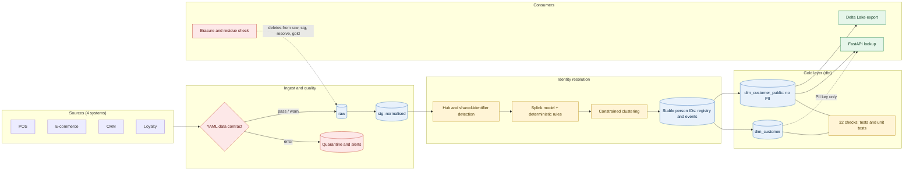

# Architecture

## Layers (DuckDB schemas)

| Schema | Contents |
|---|---|
| `raw` | landed records as received, idempotent per (source, day) |
| `stg` | normalised records: E.164 phone, lower-cased email, diacritic-free sorted name key, DOB |
| `resolve` | hub/shared identifiers, scored edges, `person_map`, `person_registry`, `person_id_events` |
| `quality` | contract violations, quarantine, monitor results |
| `privacy` | suppression list (HMAC tokens only) |
| `gold` | dbt models: `dim_customer`, `bridge_person_record`, `dim_customer_public`, `fct_identity_coverage` |

## Daily run

1. Land each source file, validating it against its YAML contract. Error-level breaches
   quarantine the file; warn-level breaches raise alerts.
2. Apply the suppression list (erased people are never re-ingested).
3. Stage and normalise.
4. Detect hub identifiers (store phones) and shared identifiers (household phones).
5. Score candidate pairs with Splink; add deterministic edges for personal phone/email.
6. Cluster with union-find under constraints (DOB conflict, max cluster size).
7. Assign stable person IDs against yesterday's registry (inherit / merge / split / new).
8. Run monitors; write alerts.
9. `cip dbt` builds the gold layer and runs 32 checks (data tests and unit tests).

## dbt vs Python

Python does what needs a model or a graph (matching, clustering, ID lifecycle). dbt does what is
relational and benefits from tests and lineage (survivorship, marts, public view). The boundary
is the `resolve.person_map` table.

## Serving

`GET /v1/persons/{id}` (301 for merged IDs, 410 for erased), `POST /v1/resolve` (phone/email in
the body, never the URL), `DELETE /v1/subjects/{id}` (admin key; disabled until configured).
`GET /health` is open.

Access is fail-closed and has two scopes:

| Scope | Headers | `GET /v1/persons/{id}` | `POST /v1/resolve` |
|---|---|---|---|
| none / wrong key | | 401 | 401 |
| `CIP_API_KEY` unset | | 503 | 503 |
| public | `X-API-Key` = `CIP_API_KEY` | `gold.dim_customer_public` row (age band, has phone/email, source counts; no name, phone, email or DOB); `?view=pii` is 403 | a unique match returns its `person_id`; hub, shared and ambiguous numbers all return `reason: "no_unique_match"` with no candidate count |
| pii | also `X-PII-Key` = `CIP_API_PII_KEY` | `?view=pii` returns the full `gold.dim_customer` record | detailed reasons (`hub_identifier`, `shared_identifier`, `ambiguous`) and candidate counts |

With `CIP_API_PII_KEY` unset the PII scope does not exist, so the API never serves direct
identifiers. Keys are compared with `secrets.compare_digest`.

Known limitation: person IDs are sequential (`P00000001`), so they can be enumerated. The key
requirement (and 401 before any 404) means an outsider cannot probe IDs at all, and a holder of
the ordinary key only sees the public view. Opaque IDs would be stronger but change the ID
stability contract, so they are left for later.
